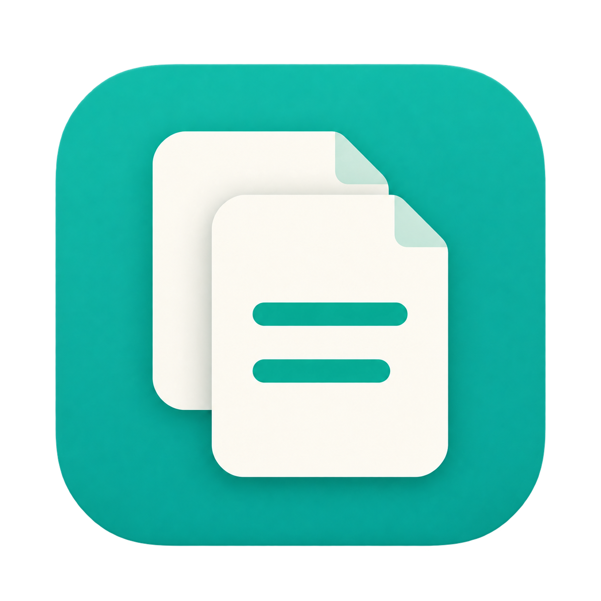
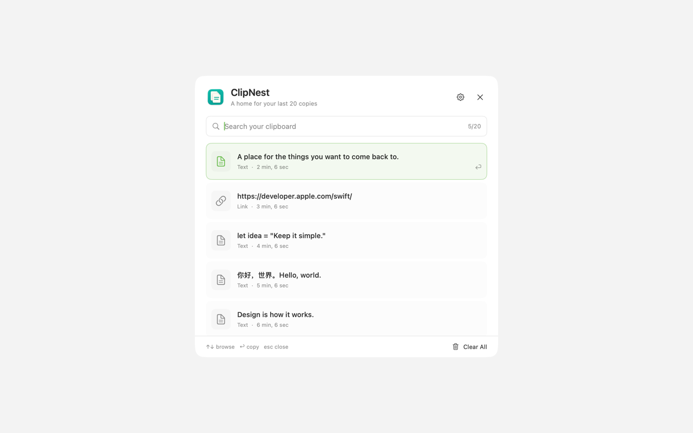

<p align="center"></p>
<h1 align="center">ClipNest</h1>
<p align="center">A small home for your last 20 copies.</p>
<p align="center">Native macOS · Swift · Free & open source · MIT</p>

[中文说明](README.zh-CN.md)

ClipNest keeps the text and links you copy in a small, centered panel. Choose a
clip, return to your app, and paste. No account, cloud service, or subscription.

<picture>
  <source media="(prefers-color-scheme: dark)" srcset="docs/screenshots/app-store-dark.png">
  
</picture>

## Use

1. Launch ClipNest and choose **Start Saving History**. It lives in your menu bar.
2. Copy text or a link in any app.
3. Press **⌥⌘V** or click the menu bar icon to open history.
4. Click a clip, or use **↑ / ↓** and **Return**. ClipNest copies it and returns
   focus to your previous app. Press **⌘V** there to paste.
5. **Escape** or a click outside closes the panel.

Search filters the 20 entries. Copying the same text again moves it to the top.
The oldest entry is removed when the limit is reached. Right-click a row to delete
it, or use **Clear All** to remove saved history. Clearing history preserves the
current system clipboard.

Open the gear button for **Launch at login** and **Pause recording**. Right-click
the menu bar icon for settings, pause, and quit. Startup is opt-in and uses the
system Login Items service; install the app in `/Applications` or `~/Applications`
before enabling it.

## Requirements and limits

- **macOS 13 Ventura or later**, Intel or Apple silicon.
- Plain text and links, preserving original whitespace. Images, files, and rich
  text formatting are outside version 1. Each clip is limited to 1 MiB of UTF-8.
- Checks for changes about every 0.6 seconds while running. Very rapid copies
  between checks can be missed; clips copied while paused or quit are not saved.
- On macOS versions with clipboard access controls, allow ClipNest under
  **System Settings → Privacy & Security → Paste from Other Apps** for background
  history. If access is denied, the app shows recovery instructions.
- Uses a system hotkey registration, without Accessibility or Input Monitoring
  permission. If ⌥⌘V is already registered elsewhere, the menu bar still works.

## Privacy

History persists locally in the sandbox's Application Support/ClipNest/history.json.
There is no network entitlement, analytics, telemetry, or cloud sync. The app skips
content marked concealed, transient, or auto-generated by its source app. Unmarked
sensitive text can still be recorded; use pause or clear when needed. History is
stored as local JSON, not separately encrypted. See [Privacy](docs/privacy.md).

## Build

Open `ClipNest.xcodeproj` in **Xcode 16 or newer**, choose the ClipNest scheme, and
run on My Mac. There are no third-party runtime dependencies. Select your own
signing team for a signed build.

For an ad-hoc local build that needs no developer membership:

```sh
xcodebuild -project ClipNest.xcodeproj -scheme ClipNest \
  -configuration Release -derivedDataPath build \
  CODE_SIGN_IDENTITY=- CODE_SIGNING_REQUIRED=NO build
open build/Build/Products/Release/ClipNest.app
```

The committed Xcode project is ready to use. If changing project configuration,
edit `project.yml` and regenerate with [XcodeGen](https://github.com/yonaskolb/XcodeGen):

```sh
xcodegen generate
```

## Verify

```sh
xcodebuild -project ClipNest.xcodeproj -scheme ClipNest \
  -destination 'platform=macOS' -derivedDataPath build \
  CODE_SIGN_IDENTITY=- CODE_SIGNING_REQUIRED=NO test
```

Tests use a private pasteboard and temporary storage. They cover eviction,
deduplication, exact text restoration, corrupt files, storage errors, sensitive
markers, pause/resume, self-copy suppression, clearing, search, and navigation.
Debug-only `CLIPNEST_PREVIEW=1` supplies isolated sample history for screenshots;
`CLIPNEST_PREVIEW=empty` shows onboarding. Both leave the general clipboard untouched.

## Source map

| Directory | Responsibility |
| --- | --- |
| `ClipNest/App` | App lifecycle, menu bar, debug preview fixture |
| `ClipNest/Core` | Entry model and bounded local storage |
| `ClipNest/Services` | Clipboard polling, global shortcut, login item |
| `ClipNest/History` | Centered panel, rows, search and selection |
| `ClipNest/Settings` | Native preferences |
| `ClipNest/Resources` | Icons, app configuration, sandbox and privacy manifest |
| `ClipNestTests` | Behavior tests |
| `Artwork` | Icon source and generation provenance |

## Distribution

This repository contains the source and App Store preparation materials. An App
Store release is **not yet available**. [Publishing instructions](docs/app-store.md)
include signing, review notes, and metadata. The intended download price is free;
Apple Developer Program membership is separate.

Contributions: open an issue with a reproducible case, or a small pull request with
relevant validation. Keep files focused and avoid adding dependencies for native features.
